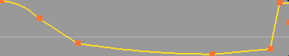

[简体中文](README.zh-CN.md) | **English**

# Better Retiming — Vegas Pro-style Velocity



Use a Vegas Pro-style velocity line in Blender's Video Sequence Editor (VSE) as a
replacement for the counter-intuitive native Retiming.

Pure-Python add-on. Edits are written as `speed_factor` keyframes on a **Speed Control**
effect strip, so rendering, preview and FFmpeg export all use the same native pipeline —
**no need to enable native Retiming**.

Native rendering and preview behavior is unaffected.

Built and tested on Blender **5.2.1**; older versions are not supported.

## Installation / update

Download the latest `seqvel-<version>.zip` from
[Releases](https://github.com/sefFumyc/Better_Retiming/releases), then:

Blender → Edit → Preferences → Add-ons → Install → choose the zip → enable it.

Then restart Blender.

## Usage

**There is no "edit mode"** — at any time, press and drag a visible line.

| Action | Effect |
|---|---|
| Drag a segment | Move both endpoints together |
| Double-click a segment | Insert a speed point |
| Drag a speed point | Change speed vertically, time horizontally |
| **Ctrl + drag (any target)** | **Fine-tune**: half the speed change (move the cursor 2px, the point moves 1px); point drags **freeze horizontal movement** (vertical only) |
| Right-click a speed point | Point menu (currently only "Delete point") |
| Right-click a segment | Segment menu: Linear / Smooth / Fast / Slow |
| **`Shift+B`** | **RAM preview**: play the current range once (audio disabled) into the VSE cache |
| Ctrl+Z / Ctrl+Shift+Z | Undo / redo per action (one step per drag / insert / delete) |

### RAM preview (`Shift+B`)

Like Vegas's Build Dynamic RAM Preview: **press once and the current range is played frame
by frame**; when it finishes, the playhead returns to the range start, and your own playback
of that range is smooth.

Press `P`, then left-drag to box-select the range.

By default, `Shift+B` conflicts with Blender's default (zoom to border) shortcut. It is
recommended to change Blender's binding to `Ctrl+B` to avoid the conflict.

<br />

### Default curve type for new curves (panel dropdown)

**Default = Smooth**

For a straight ramp, switch the dropdown back to "Linear".

If you have already edited the speed (the SPD layer has been created), this option no longer
applies; delete the velocity line and trigger it again for the setting to take effect.

### When speed percentages appear

- **Always** → every speed point always shows its percentage.
- **While dragging (default)** → no numbers normally; during a drag, only the points being
  changed are shown temporarily.

<br />

## Panel (don't bother — mostly debug output)

The sidebar tab is called **Velocity** (English only; Blender does not support renaming tabs
at runtime). The panel is the only information outlet, ordered **top to bottom** — settings
first, diagnostics last:

1. **Language** — `English / 中文`, factory default English. It lives in the add-on
   preferences (a user property, not a project property) and persists across `.blend` files;
   switching takes effect immediately and covers runtime text (panel, context menus including
   the four segment type names, notices and reports). Text fixed at registration time (the
   sidebar label `Velocity`, menu titles, operator and setting tooltips) cannot be switched
   at runtime, so it stays bilingual English/Chinese; the sidebar label itself is English only
   as requested.
2. **Settings** — **Display** (hide the native Retiming display while editing, show speed
   percentages) and **New curve** (default segment curve type, **speed display cap** 300% /
   1000%).
3. **Target strip** — the active strip (active first, then the selected source strip) and a
   delete button; when no usable target exists the panel explains why (how many strips are in
   the scene, how many are selected, which one is active) instead of just showing "(None)";
   failures when reading the strip list or active strip print the exception text (not
   swallowed silently). Selecting an audio/effect strip or another non-editable strip states
   the reason directly.
4. **RAM preview** — this range (with its source: preview range / scene range), roughly how
   many MB it needs and the current cap, plus what is currently available (not built /
   building with percentage / built to frame N and cache size / memory full / stopped early /
   invalidated / aborted).
5. **Status warnings** — editing/audio notices, scene source mismatch, subframe limitations.
6. **Debug area (bottom)** — always shows `timeline region <size> · hit <result>` while
   editing (to tell at a glance whether nothing was hit or something was hit but did not
   move), carrier status, segment type distribution, and version.

When the carrier input is a scene source, the panel also always shows this scene's raw cache
state: when subframe precision is swallowed by it, it shows "subframe limited" with a
one-click toggle (changes only when clicked, click again to restore).

## Development

Layered (do not skip layers):

```
seqvel/curve.py        pure-Python shadow model (single source of truth, no bpy)
seqvel/geometry.py     strip coordinate mapping and hit testing (pure Python)
seqvel/rules.py        strip type rules (pure Python)
seqvel/regions.py      locate the timeline region (pure Python) — context.region is unreliable
seqvel/editing.py      interaction primitives: double-click detection, right-click targets (pure Python)
seqvel/ram.py          RAM preview rules: range / memory accounting / watermark decision, no bpy
seqvel/store.py        model cache and persistence (strip custom properties)
seqvel/carrier.py      landing mapping: Speed Control + speed_factor keyframes
seqvel/watch.py        strip span listener: end carry / point swallow, carrier re-landing (frame map rebuild), RAM preview invalidation (ADR-0004 revision R1)
seqvel/preview.py      RAM preview build operator (Shift+B, ADR-0011)
seqvel/overlay.py      overlay drawing (draw handler + gpu/blf)
seqvel/hover.py        hover cursor (MOUSEMOVE keymap → HAND_POINT)
seqvel/interaction.py  direct-manipulation modal operators and point / segment menus
seqvel/status.py       runtime state (single exit for panel text and diagnostics)
seqvel/ui.py           sidebar panel and settings
```

`curve` / `geometry` / `rules` / `regions` / `editing` / `ram` are bpy-free layers; `store` /
`watch` have their own `try: import bpy` fallback — so these layers can be run under plain
Python without Blender. The corresponding hard constraint is that `seqvel/__init__.py`
**must not touch bpy at module level** (not even decorators), otherwise even
`import seqvel` fails under pure Python; `persistent` app handlers are attached during
`register()`.

<br />

## Documentation

- `CONTEXT.md` — domain glossary (speed line, speed point, segment, shadow model, speed
  carrier, and more)
- `docs/adr/` — architecture decision records (11 so far)
- `research/` — upstream data model, source image cache, and drawing interaction notes

## License

GPL-2.0-or-later. See [LICENSE](LICENSE).
